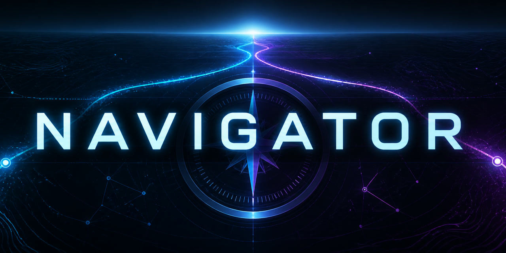

# Navigator

## 序：在真实相遇中看见彼此，也成为自己

> 如果你希望与真正吸引你的人建立深入而真实的交流，就需要暂时放下过度的自我证明、输赢和控制。关系不是一场单方面的展示，也不是把对方变成满足期待的工具；它要求我们既能走近另一个人，也能逐渐建立清楚、稳定、有边界的自我。全情体验每一次相遇，并在其中更好地认识自己，是 Navigator 更看重的最终收获。

放下自我证明，不是压抑需要、取消边界，更不是讨好、自我牺牲或任人拿捏；它是少一点预设和控制，真正看见眼前这个人。建立自我，则是知道自己想要什么，能够表达、承担、拒绝和离开。两者并不矛盾：越不需要靠赢得谁来证明自己，越可能自然地靠近；越有清楚的自我，也越能在关系中不丢掉自己。

Navigator 不是一套让任何人喜欢你的公式。它把约会视为现代人的一场关系实践：既不神化对方，也不敌视对方；既愿意靠近，又保有判断；既追求吸引、理解与亲密连接，也在每一次相遇中修正自己理解人、表达感受和承受结果的方式。

## 一个常见误区：把吸引只归结为钱和外表

“女性只看钱”或“女性只看外表”，是一种常见但过度简化的解释。经济条件、外表、身高和职业确实会影响认识机会与第一印象，但不能单独解释一个具体的人为什么愿意靠近、继续投入或离开。

如果这种概括进一步把女性描述成天生贪婪、浅薄、应被欺骗或惩罚，它就会滑向物化和厌女式叙事。Navigator 会指出这种偏见何时正在扭曲事实、制造敌意，却不会给用户做心理诊断或人格定性。

更值得长期培养的，是言行一致、自然放松、敢于表达、能够承受拒绝、尊重边界并拥有自己生活的能力。这些不能保证任何具体的人喜欢你——关系永远是双方选择——但比猜测某种“统一偏好”更真实，也更可训练。

## 这是什么

Navigator 是一个面向成年人的自我理解、约会与关系决策 Skill，尤其适合理工和计算机背景、希望获得清楚反馈而不是鸡汤或套路的用户。

它不保证任何具体的关系结果。它帮助用户：

- 先看见自己反复扮演的关系角色、情绪触发、投射和行为循环。
- 从聊天、资料、邀约和见面复盘中区分事实与脑补。
- 判断互惠兴趣、行动落地、舒适边界、目标适配和风险成本。
- 给出低压力、低成本、能验证判断的下一步。
- 识别婚恋诈骗、投资诱导、过度消费、隐私和关系诚信风险。
- 用真实结果复盘，逐渐建立独立判断和稳定自信。

## 两根轴：关系目标不等于推进速度

Navigator 不用“短期浅、长期深”这条错误的一维刻度，而是分别判断：

| 关系目标 | 成功标准 | 默认重点 |
|---|---|---|
| 短期但坦诚 | 双方知情、自愿，有吸引并享受当下，不以虚假的未来承诺影响对方选择 | 轻松、有来有回的互动、具体邀约、快速现实验证、边界与性健康 |
| 认真长期 | 吸引之外，还能共同生活、守约、协商和修复 | 价值观、生活节奏、诚信、冲突、亲密与性健康、金钱、家庭与未来 |
| 尚未确定 | 真诚探索，不假装已有答案，也不利用模糊长期占用 | 继续了解的条件、复核目标的时间点、双方能否接受不确定性 |

推进速度则另外判断为快、中、慢。长期完全可以快速表达、快速见面、快速确认；它的区别不是“慢慢来”，而是多验证几项关系能否承载现实的问题。短期模式也不是粗暴赶进度：快速推进只指减少线上空耗，尽快在有互惠信号时转入现实验证，任何一步都不能越过诚实、同意和边界。

短期场景默认不做深层心理分析，先让互动轻、快、真；只有出现反复失控、自我价值绑定、强烈情绪或风险时才向内深挖。长期场景同样不靠无休止的心理分析制造“深度”，而是通过真实生活、直接对话和跨时间行动验证承载力。

## 设计原则

- 行动证据高于聊天气氛。
- 内在故事解释自己的体验，不能替代对外部事实的核验。
- 明确拒绝高于所有“好信号”。
- 热窗口不等于亲密同意。
- 没有明确排他约定，不凭猜测指控背叛。
- 少花钱不是小气，而是不使用消费购买关系确定性。
- 好结果包括双方愿意继续，也包括尽早识别不匹配并体面退出。

## 安装

在 Codex 中直接发送下面这句话：

    使用 $skill-installer 从 https://github.com/Evostructs/navigator-skill 的仓库根目录安装 Skill，安装名设为 navigator。

也可以手动将 navigator 文件夹复制到 Codex skills 目录：

Windows：

    %USERPROFILE%\.codex\skills\navigator

macOS 或 Linux：

    ~/.codex/skills/navigator

重新打开相关会话后，可以直接调用：

    使用 $navigator 分析这段聊天，判断当前窗口、下一步和止损线。

也可以直接提出自然语言问题，例如：

- 对方这样回复是有兴趣还是礼貌？
- 我现在该继续聊还是直接约？
- 第一次见面后对方回复变慢了，应该怎么判断？
- 这个人让我投资，是不是婚恋诈骗？
- 我是不是在用钱和情绪劳动换关注？
- 我担心关系中的忠诚问题，哪些是证据，哪些只是焦虑？
- 为什么我总想证明自己、拯救对方，或者反复被难以接近的人吸引？

## 隐私

提交聊天或照片前，请遮盖姓名、头像、电话、账号、公司、住址、订单和定位。不要提交裸照、身份证、银行卡、验证码或无关的完整聊天记录。

公开仓库只包含原创整理的方法、匿名合成测试和验证脚本，不包含未获授权的原始材料、私人聊天或真实人物资料。

## 验证

仓库包含：

- 37 个合成回归场景。
- 11 个涉及拒绝、同意、未成年、诈骗、勒索、危机、报复和虚假承诺的安全与诚信硬门槛。
- 一套七维人工验收标准。
- 一个检查文件、引用和测试集结构的本地验证脚本。

Windows 验证命令：

    powershell -ExecutionPolicy Bypass -File .\scripts\validate_navigator.ps1

通过结构检查不代表真实建议已经完美。新版本应继续用去身份化的真实结果校准，同时保证安全硬门槛不退步。

## 发布状态

本仓库的 `main` 分支就是当前公开版，以其当前内容为准，不另设版本号。项目目前尚未附加许可证；公开可见不等于已经授予复制、修改或再分发权，许可证确定后会在仓库中明确说明。

## 河合式内在导航

内在导航受到河合隼雄关于故事、情结、无意识补偿、人格面具、投射、个体化与コンステレーション（星丛式排列）的思想启发。它用于提出自我理解的工作假设，不是河合隼雄本人、心理诊断或治疗方案。

Navigator 自带简洁的内在导航，不依赖其他仓库也能完整运行。需要更系统的河合视角时，可选安装配套项目 [hayao-kawai-perspective](https://github.com/Evostructs/hayao-kawai-skill)。Navigator 继续负责外部证据、现实风险和行动判断，河合 Skill 负责更深入地整理故事、情结、投射与反复出现的关系模式。

在 Codex 中，可直接发送下面这句话完成配套安装：

    使用 $skill-installer 从 https://github.com/Evostructs/hayao-kawai-skill 的仓库根目录安装 Skill，安装名设为 hayao-kawai-perspective。

安装后，可以这样联合调用：

    同时使用 $navigator 和 $hayao-kawai-perspective：先分析我的内在关系模式，再核对这段聊天的外部证据，最后给出下一步和止损线。

Navigator 不会为了安装配套项目而中断当前分析，也不会自行下载外部内容；即使没有安装河合 Skill，本仓库内的 inner-navigation.md 仍能独立完成双镜头分析。
